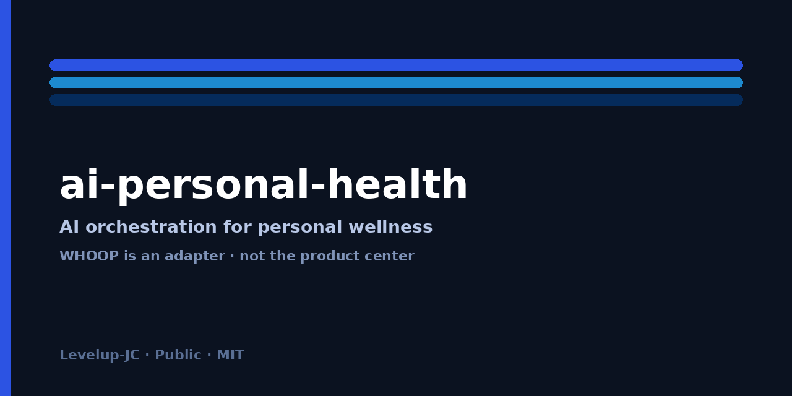

# ai-personal-health

[](https://github.com/Levelup-JC/ai-personal-health)
[](https://github.com/Levelup-JC/ai-personal-health)
[](./docs/SOLUTION.md)
[](./LICENSE)

<p align="center">
  
</p>

> 用 AI 编排管理个人健康：日概览、趋势、训练饮食台账与轻量建议。WHOOP 只是数据适配器之一，不是产品中心。

## 简介

`Levelup-JC/ai-personal-health` 是一套 **个人 wellness 编排方案骨架**：通过 Grok Bot / Agent 连接 WHOOP MCP、Notion 台账与手动录入（口述/餐照），产出可追溯的日/周健康闭环。本仓库以中文方案文档为主，含适配器约定与 Agent 边界；**不提供医疗诊断**，不在仓内存放密钥或真实健康数据。

## 功能特性

- AI 编排：日概览、多日趋势、训练/饮食台账、轻量建议、周复盘
- 数据适配器抽象：WHOOP（主可穿戴）、Notion 正本、手动录入；Apple Health 等为后续
- 韧性：缺数据追问、连接失败降级、红旗就医提醒
- 隐私：数据流出清单、ntfy 正文不含健康数值、运维秘册仓外
- 可选离线 dashboard 构建模式（仅合成样例进仓）
- 家庭健康 Agent 边界在 MVP 文档即隔离

## 快速开始

1. 阅读 [`docs/SOLUTION.md`](./docs/SOLUTION.md) 与 [`docs/ARCHITECTURE.md`](./docs/ARCHITECTURE.md)。
2. 复制 `.env.example` → `.env`，填入仓外持有的凭证（**勿提交**）。
3. 在 Grok Bot 中确认连接器 `whoop-personal-vps` 与 Notion 健身库可用。
4. 按 [`agents/README.md`](./agents/README.md) 区分「健身管理」与「家庭健康管理」。
5. （可选）用 `examples/synthetic/` 练习 dashboard 构建；不要拷贝生产 raw。

> 本仓当前以 **文档骨架** 为主；运行时编排默认在 Owner 的 Grok Bot 内完成。

## 目录结构

```text
ai-personal-health/
├── README.md
├── LICENSE                 # MIT，待 Owner 确认
├── .env.example
├── .gitignore
├── docs/
│   ├── SOLUTION.md         # 完整方案（含 mermaid）
│   ├── ARCHITECTURE.md
│   ├── DATA-SOURCES.md
│   └── ops/README.md       # 指向仓外运维私册
├── adapters/README.md
├── agents/README.md
├── examples/synthetic/     # SYNTHETIC 样例
└── .github/assets/
    └── readme-cover.png    # 封面占位（待补 1280×640）
```

## 文档与正本

| 文档 | 用途 |
| --- | --- |
| [`docs/SOLUTION.md`](./docs/SOLUTION.md) | 愿景、架构、SSOT、隐私、分期、DoD |
| [`docs/ARCHITECTURE.md`](./docs/ARCHITECTURE.md) | 组件与接口、失败模式 |
| [`docs/DATA-SOURCES.md`](./docs/DATA-SOURCES.md) | 数据源矩阵与最小 schema |
| [`adapters/README.md`](./adapters/README.md) | 适配器约定 |
| [`agents/README.md`](./agents/README.md) | Agent 职责与隔离 |
| [`docs/ops/README.md`](./docs/ops/README.md) | 运维指针（无密钥） |
| Owner Notion「健身管理 记忆」 | 运行时偏好/规则正本（仓外） |

## 技术栈

- 编排：Grok Bot / Agent + MCP
- 可穿戴：自建 WHOOP HTTP MCP（连接器逻辑名 `whoop-personal-vps`）
- 台账：Notion
- 通知：自建 ntfy（逻辑引用）
- 文档：Markdown + Mermaid
- 可选：Python dashboard build（raw→html）；Magpie 用于方案评审

## 相关仓库

| 仓库 / 资源 | 关系 |
| --- | --- |
| `Levelup-JC/ai-personal-health` | 本仓（方案与约定） |
| whoop-personal-mcp（上游/自建） | WHOOP MCP 实现参考；不强制 vendoring |
| fitness-dashboard（私有草稿） | dashboard 模式可复用；进本仓前须 scrub |
| `ai-personal-health-ops`（建议私有） | 部署与密钥私册（待建） |

## 维护

- 维护方：Levelup-JC / Owner
- 变更：先改 `docs/SOLUTION.md`，再同步 adapters/agents
- 安全：疑似泄露立即轮换仓外密钥，并开启 GitHub Secret Scanning / Push Protection
- 例程与现网告警配置不在本仓修改

## 许可

MIT License（见 [`LICENSE`](./LICENSE)）。**草稿待 Owner 确认后**再打首个正式 release 标签。

使用本项目即表示你理解：输出仅为 wellness 信息，**不是**医疗建议或诊断。
