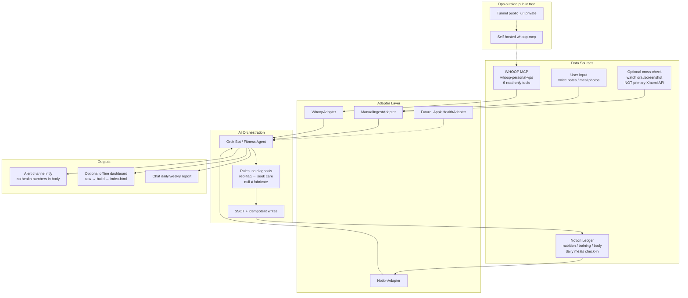

# 完整方案 · AI Personal Health（用 AI 管理个人健康）

> 仓库：`Levelup-JC/ai-personal-health`（Public）  
> 文档语言：中文为主；章节标题可英文化。  
> 状态：方案骨架定稿（经 Magpie → `apikeyfan/claude-opus-5-5` 有条件通过后按 M1–M11 修订）。  
> **免责声明：本系统仅提供 wellness 信息，不诊断、不治疗、不开具处方、不构成医疗建议或运动清关。**

## 1. Vision（愿景）

用 **AI 编排** 把多源健康信号收成可行动的日常闭环：日概览、多日趋势、训练与饮食台账、轻量建议、缺数据追问、连接失败降级、异常/伤痛就医提醒、周复盘。

**WHOOP 是 Adapter，不是产品中心。** 可穿戴、Notion 台账、口述与餐照都通过统一适配器进入编排层。

非目标（MVP/v1）：临床诊断、多租户 SaaS、替代执业医师/教练。

## 2. Goals & Non-goals

| 目标 | 说明 |
| --- | --- |
| 日概览 | 当天恢复/睡眠/负荷/训练/饮食要点，数值可追溯 `source` + `fetched_at` |
| 多日趋势 | Recovery / HRV / Sleep / Strain 等窗口解读（wellness 语境） |
| 台账 | 训练、饮食、身体指标写入 Notion（幂等、可审计） |
| 轻量建议 | 基于个人基线偏离的提示，禁止病名/用药/剂量 |
| 韧性 | MCP/Notion 失败时降级文案，不编造数值 |
| 隐私 | 仅向「数据流出清单」内目的地发送最小必要字段 |

| 非目标 | 说明 |
| --- | --- |
| 医疗诊断 | 红旗症状直接就医提醒，停止训练建议 |
| 小米健康主源 | 小米/IFTTT 仅作叫醒相关；不作主指标源 |
| 仓内运维秘册 | VPS IP、隧道 URL、Bearer、真实 ntfy 域名等见仓外 ops |

## 3. Personas & Agent Boundaries

| 角色 | 职责 | 数据边界 |
| --- | --- | --- |
| Owner（主用户） | 本人训练/睡眠/饮食闭环 | 健身侧 Notion 库 + WHOOP MCP |
| Agent「健身管理」 | 编排、录入、报表、追问 | 只读写健身库；不可访问家庭库 |
| Agent「家庭健康管理」 | 家人健康协助 | **独立** Notion integration/库/连接器；MVP 即隔离 |
| 未成年人 | — | 从严：需监护人知情同意；默认不入库 |

详见 [`../agents/README.md`](../agents/README.md)。

## 4. Architecture（架构）

组件与接口细节见 [`ARCHITECTURE.md`](./ARCHITECTURE.md)。数据源表见 [`DATA-SOURCES.md`](./DATA-SOURCES.md)。

## 5. Modules（模块）

1. **Data Adapters** — 统一拉取/归一化；契约见 adapters。
2. **Ledger（Notion）** — 写入正本按实体唯一（下节 SSOT）。
3. **Orchestration** — 日概览、趋势、建议、追问、降级、红旗。
4. **Presentation** — 对话；可选 dashboard（源自 fitness-dashboard 模式，进仓须 scrub）。
5. **Alerting** — 「每晚健康报表」能力描述（约 19:00）；**方案不 resume 已停例程**。
6. **Ops pointer** — [`ops/README.md`](./ops/README.md) 指向仓外私册；本仓不含 VPS 部署手册正文。

## 6. SSOT（正本规则）

| 实体 | 唯一正本 | 派生 / 视图 | 禁止 |
| --- | --- | --- | --- |
| 饮食条目 | Notion「饮食记录」库 | 「每天吃的饭」打卡页（完成状态视图） | 记忆页存卡路里数值 |
| 训练条目 | Notion「训练记录」库 | Dashboard 今日训练区 | 记忆页存组数重量作唯一真相 |
| 身体指标 | Notion「身体数据」库 | Dashboard 体重卡 | 口述估计未标注来源 |
| 可穿戴当日度量 | WHOOP MCP 即时读取（不落库或可选缓存） | 趋势图 | 把 LLM 摘要当度量正本 |
| 偏好与规则 | 「健身管理 记忆」页 | Agent system 提示 | 记忆页存 HRV/体重时间序列 |

## 7. Write Safety（写入安全）

- **幂等键**：`date + source + source_id`（口述可用内容哈希短码）。
- **去重**：同餐口述与餐照冲突时合并为一条，保留更高置信来源。
- **写前确认（MVP）**：Agent 出示草稿 → Owner 确认 → 再写 Notion。
- **审计字段**：`created_by`（`agent|user`）、`source`、`confidence`、`估算|实测`。
- **修改/撤销**：Notion 页内修正；Agent 提供「撤销上一条」对话路径（软删标记，不物理抹除审计）。

## 8. Normalized Contract（最小契约）

见 [`DATA-SOURCES.md`](./DATA-SOURCES.md) 与 [`../adapters/README.md`](../adapters/README.md)。要点：

- 单位显式（bpm、ms、%、hours、kcal）。
- 时区默认 `Asia/Shanghai`；睡眠按 **醒来日** 归属。
- `null` = 无数据；`0` = 真实为零；禁止用 0 填缺失。
- 冲突优先级（主指标）：`WHOOP > 口述实测 > 截图转录 > 估算`；小米健康 **不进入** 主优先级链。

## 9. Required Capabilities（必须能力）

| 能力 | 行为 |
| --- | --- |
| 日概览 | 聚合 WHOOP overview + Notion 当日台账 |
| 多日趋势 | recovery/hrv/sleep/training_load 窗口 |
| 训练饮食台账 | 口述/餐照入库（餐照：先 AI 桌面白底 Ins 风，再写库；保留原图作估算依据的约定见 adapters） |
| 轻量建议 | 基线偏离提示 + 非医疗免责 |
| 缺数据追问 | 关键字段缺失最多追问 1 次，不阻塞其余概览 |
| 连接失败降级 | MCP/Notion 超时 → 固定降级文案，不编造 |
| 伤痛/红旗 | 胸痛、晕厥、呼吸困难、外伤剧痛等 → 固定就医文案，停止训练建议 |
| 隐私 | 不外发清单外目的地；密钥不进聊天/Git；Bearer 与隧道 URL 运维分离 |

## 10. Data Egress Inventory（数据流出清单）

原则改为可验证表述：**仅向下列目的地发送最小必要字段。**

| 目的地 | 字段级别 | 保留策略 | 可关闭 |
| --- | --- | --- | --- |
| WHOOP 官方 API（经自建 MCP） | 可穿戴原始/计算指标（只读拉取） | 依 WHOOP 与自建 MCP 策略 | 否（无此源则无佩戴数据） |
| Grok Bot / LLM 提供方 | 编排所需摘要与工具返回；避免姓名/设备 ID | 依平台条款 | 可降级为「仅台账、不解读」 |
| Notion | 台账字段、餐照处理后的附件 | 依 Notion 条款 | 否（台账正本） |
| 餐照风格化模型 | 图像像素；应避免人脸以外隐私背景 | 依模型提供方 | 可改为纯口述 |
| Alert channel（ntfy） | **禁止健康数值**；仅「报表已生成 / 请查看」 | 短期 | 可 |
| 离线 dashboard 文件 | 归一化 JSON（本地）；Public 仓仅合成样例 | 本地 | 可 |

## 11. Alert Copy Rules（告警文案）

- 阈值 = 个人基线偏离的 wellness 提示，**不对应疾病判断**。
- 禁止：病名、「可能患有」、用药、剂量、运动清关用语。
- ntfy 正文示例：「今晚健康报表已生成，请打开健身管理查看。」
- 红旗固定回复：「你描述的情况需要尽快联系专业医疗人员或急诊。我不会继续给出训练建议。」

## 12. Existing Landing（已知落地 · 逻辑名）

> Public 仓只写逻辑名。具体主机、隧道、Bearer、Notion collection id 在仓外 ops 私册。

| 项 | 逻辑名 |
| --- | --- |
| WHOOP 连接器 | Grok Bot MCP `whoop-personal-vps`（HTTP）；旧 `whoop-personal` **废弃，应下线** |
| MCP 工具 | `whoop_get_today_overview` / `recovery_trend` / `hrv_trend` / `sleep_trend` / `training_load` / `workouts` |
| 自建 MCP | `whoop-mcp (self-hosted)`；`public_url` 文件需运维核对（隧道重启可能变化） |
| Agents | 「健身管理」「家庭健康管理」 |
| 告警通道 | `alert-channel: ntfy (self-hosted)`；本仓不改其配置 |
| 例程能力 | 「每晚健康报表」约 19:00；**文档只描述能力，不 resume** |
| 可复用实现 | fitness-dashboard 模式（raw→build→index）；whoop-personal-mcp 上游参考（不强制 vendoring） |

## 13. Roadmap

### MVP
- 文档骨架（本仓）+ 适配器约定 + Agent 边界
- WHOOP 只读接入编排 + Notion 台账读写约定
- 日概览对话、缺数据追问、连接失败降级、红旗文案
- 家庭隔离机制写明（独立 integration/库/Agent）
- Public 安全：`.gitignore`、无真实数据、Secret Scanning 建议
- **DoD（可测）**：见下节

### v1
- 趋势解读模板、训练/饮食建议模板
- 每晚报表例程（经 Owner 拍板后再启用）
- Dashboard 开源骨架（仅合成数据）
- 适配器接口稳定 + 契约测试
- 评估固定隧道 + 访问控制（风险登记）

### v2
- Apple Health 等适配器
- 家庭边界产品化体验
- 更强告警策略、可选本地模型降级路径
- 字段级加密 / 导出 / 审计日志增强

## 14. MVP Definition of Done

| # | 条目 | 通过标准 |
| --- | --- | --- |
| 1 | 无敏感进仓 | gitleaks（或等价）对将推送内容 0 findings |
| 2 | 日概览可追溯 | 每个展示数值带 `source` + `fetched_at`（或明确「数据缺失」） |
| 3 | 失败降级 | MCP 超时/失败 → 固定文案，无编造数字 |
| 4 | 缺数据追问 | 关键缺失最多 1 次追问，其余块仍输出 |
| 5 | 写入安全 | 重复录入不产生双条（幂等）；MVP 写前确认 |
| 6 | 红旗 | 触发后无训练建议，仅就医提醒 |
| 7 | ntfy | 推送体无健康数值 |
| 8 | 免责 | 用户可见输出含非医疗声明 |
| 9 | 家庭隔离 | 文档与配置路径证明健身连接器无法读家庭库 |
| 10 | 合成样例 | `examples/synthetic/` 标注 SYNTHETIC |

## 15. Privacy & Compliance Notes

- 健康数据按敏感个人信息处理（如适用 PIPL）；最小化、可追溯、可删除。
- Public 仓禁止真实健康样本、真实 Prompt 填充、真实对话记录。
- 密钥轮换：Bearer / Notion token / ntfy token 均在仓外；泄露即轮换。
- 本软件 **不是** 医疗器械。

## 16. Open Decisions for Owner

1. LICENSE 是否确认 MIT（当前草稿）。
2. 是否另建私有 `ai-personal-health-ops` 放部署手册（本仓默认 **不含** 部署手册正文）。
3. 旧连接器 `whoop-personal` 下线日期。
4. 例程「每晚健康报表」何时允许 resume（全局例程拍板之后）。

## 17. Review Record

- Magpie gateway → model requested `apikeyfan/claude-opus-5-5`，served `claude-opus-5-5`。
- 结论：**有条件通过**；本文件已吸收 M2–M11（Public 运维外置、流出清单、SSOT、写入安全、契约、告警文案、家庭隔离、ops 指针、MVP DoD）。
- M1 所述「路径损坏编码串」在初稿原文中未复核到真实凭据片段；定稿统一改为占位符，避免误收运维字面量。
